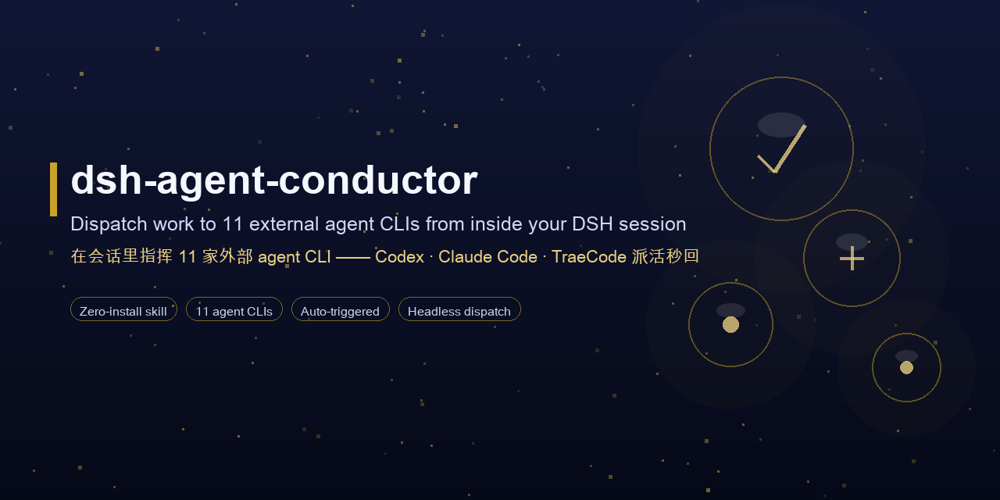

<div align="center">



# ⚡ dsh-agent-conductor

### *Let your DeepSeek Harness agent dispatch tasks to 11 external agent CLIs — Codex, Claude Code, TraeCode, OpenCode, Gemini, Cursor, Kimi, Qwen, Copilot, WorkBuddy, Grok — headlessly, and bring results back into the conversation.*

**New in 0.4.0:** the **大肥鱼指挥官 (Big Fat Fish Commander)** panel — a live fleet view of bundle dispatches, right in the DSH sidebar.

[](LICENSE)
[](https://github.com/MJorgin/dsh-agent-conductor/actions/workflows/ci.yml)
[](https://github.com/topics/dsh-plugin)
[](skills/conductor/scripts/dispatch.py)
[](README.md#-agents)

**English** · [**简体中文**](docs/lang/README_ZH.md)

</div>

---

DeepSeek Harness is a great reasoning engine — but sometimes the job is better done by *another* coding agent: a Codex translation, a Claude Code investigation, a Cursor refactor. This plugin lets your DSH agent **recognize when to delegate** (by skill-description matching), **dispatch a self-contained task** to one of 11 external agent CLIs in headless mode, and **bring the stdout result back as the answer** — while the **大肥鱼指挥官** panel shows the fleet's live status.

> Inspired by [Multica](https://github.com/multica-ai/multica) — the "agent squad" idea as a zero-install DSH skill.

## 🎯 When to use Conductor

- **Independent second opinion:** ask Codex, Claude Code, or Gemini to review the same design and compare their reasoning.
- **Legacy-code investigation:** have one agent trace a call chain while another checks risks, regressions, and migration options.
- **Cross-model implementation:** use an agent whose toolchain or model fits the job, then bring its result back to DSH.

## ✨ What you get

| Capability | What it does | Cost |
|---|---|---|
| 🧠 Auto-triggered dispatch | Say "have Codex translate this README" — the model matches the skill, runs the dispatch script, and answers from the result | Free (uses the target CLI's quota) |
| 🔧 `conductor_dispatch` tool (optional bundle) | The same registry as a first-class DSH tool, installed into a profile with one command | Free |
| 🐟 大肥鱼指挥官 panel (bundle) | Sidebar tab just above 更多: 11 chibi crew cards with live status, elapsed time and output tail, a ship log, per-run detail and a 终止 button, and adjustable history retention | Free |
| 🩺 `doctor` self-check | `python3 dispatch.py doctor` probes which CLIs are installed (resolves PATH + tries `--version`) before you dispatch | Free |
| 👀 Dry-run preview | Preview the target, working directory, argv, and shell-equivalent command without starting an external agent | Free |
| 👥 11 agent CLIs | Codex, Claude Code, TraeCode, OpenCode, Gemini, Cursor, Kimi, Qwen, Copilot, WorkBuddy, Grok | Their login quotas |
| 🔒 Privacy | Task text goes only to the CLI's own provider; keys stay local | — |

## 🧭 Why a Skill (and not just a plugin)

| | profile plugin / bundle | dynamic plugin | **Skill (this repo)** |
|---|---|---|---|
| Install | write profile + restart | define in-session | **copy a folder** |
| Trigger | manual | model calls a tool | **description matching, model auto-recognizes** |
| Risk | touches the host | session-scoped, gone on restart | read-only script, host-agnostic |
| Result | tool result | tool result | **stdout directly becomes the answer** |

One `SKILL.md` + a zero-dependency `dispatch.py` (Python stdlib only).

## ⚡ Quick start (Skill)

Copy `skills/conductor/` to any skill root (project-level `.dsh/skills/` or global `~/.dsh/skills/`):

```sh
mkdir -p .dsh/skills/conductor
cp -R skills/conductor/. .dsh/skills/conductor/
```

No restart needed — from the next message on, just say:

- "派 codex 把这份 README 翻译成繁体中文" (have Codex translate this README)
- "让 Claude Code 查一下这个报错的成因" (ask Claude Code to investigate this error)
- "用 Codex 独立实现一个 XXX" (have Codex implement XXX independently)

The agent auto-recognizes the need (SKILL.md description matching) → runs `dispatch.py` → returns the result.

Before an unfamiliar or potentially write-producing dispatch, preview it without consuming the target agent's quota:

```sh
python3 skills/conductor/scripts/dispatch.py --dry-run claude-code "Read src/auth.ts and explain the token refresh flow. Do not edit files."
```

## 🧭 Agent capability matrix

| Task | First choices | Why |
|---|---|---|
| Architecture review / second opinion | Codex, Claude Code, Gemini | Different reasoning styles are useful for catching design blind spots |
| Legacy-code call-chain investigation | Claude Code, Codex, Copilot | Good for tracing repository-local dependencies and attaching evidence |
| GitHub-centric issue or Actions analysis | Copilot, Codex | Natural fit for repositories, pull requests, and CI diagnostics |
| Editor-coupled refactor | Cursor, Codex | Useful when the workflow is tightly connected to an existing project tree |
| Chinese localization / Chinese docs | TraeCode, Qwen, Kimi, Codex | Strong Chinese-language options; keep terminology consistent in the task |
| Fast alternative implementation | OpenCode, Qwen, Kimi | Useful for bounded spikes where a separate login/toolchain is available |

The matrix is a routing starting point, not a hard rule. Prefer an installed, logged-in CLI that has access to the correct workspace.

## 📋 Copy-ready dispatch recipes

1. Safe diagnosis:

```text
You are investigating a bug in the current repository. Do not edit files.
Reproduce the issue from this description: <paste error and steps>.
Read only the minimum relevant files. Return:
1) root cause, 2) evidence with file:line, 3) three ranked fix options,
4) tests that should be added or updated.
```

2. Independent architecture review:

```text
Review this design as an outside staff engineer. Do not assume hidden context.
Design summary: <paste PRD/technical plan>.
Challenge scalability, failure modes, security boundaries, and migration risk.
Return disagreements first; for each, include impact, evidence, and a fallback.
```

3. Test-backed implementation:

```text
Implement this change in the current repository: <scope and acceptance criteria>.
Work in small steps. Add or update tests first where practical.
Before finishing, run the relevant test command and report:
files changed, tests run, remaining risks, and follow-up work.
```

## 🛠️ Prereqs: install the CLIs you want to dispatch to

```sh
# Codex / Claude Code / OpenCode / Gemini / Qwen
npm i -g @openai/codex
npm i -g @anthropic-ai/claude-code
npm i -g opencode-ai
npm i -g @google/gemini-cli
npm i -g @qwen-code/qwen-code
# Kimi / Grok / Copilot (headless flags verified against each CLI's own --help)
npm i -g @moonshot-ai/kimi-code
npm i -g @xai-official/grok
npm i -g @github/copilot
# TraeCode CLI: https://docs.trae.cn/cli_command-line-parameters
# (already have codex-cli? symlink instead: ln -s ~/.codex/plugins/.plugin-appserver/codex ~/.local/bin/codex)
```

> Headless note: Copilot non-interactive mode must auto-approve tools, so the registry runs `copilot -p "<task>" --allow-all-tools`. The other CLIs run their standard print/headless flag.

Then check what's actually dispatchable on this machine:

```sh
python3 skills/conductor/scripts/dispatch.py doctor
# ✅ Codex  …/codex — codex-cli 0.151.0 …
# ❌ Gemini … 未找到 `gemini`  →  安装：npm i -g @google/gemini-cli
```

> **Working directory is auto-detected.** The bundle tool runs each CLI in the current session's workspace (`exec.agent.session.header.cwd`), then `CONDUCTOR_CWD`, then the harness cwd — no hardcoded paths. Codex still requires a *trusted* git repo: point `CONDUCTOR_CWD=/path/to/git/repo` (env or `~/.dsh/secrets/media-tools.env`) at one if the auto-detected folder isn't trusted. The skill script honors `CONDUCTOR_CWD` and falls back to the current directory.
> **Codex model override.** Codex reads its model from the shared `~/.codex/config.toml`; if that model isn't available to the current account, set `CONDUCTOR_CODEX_MODEL=<model>` (env or `~/.dsh/secrets/media-tools.env`) and the bundle/dynamic tool and the skill script insert `-m <model>` automatically.
> **Windows.** The skill script resolves npm `.CMD` shims through `PATHEXT` and decodes CLI output as UTF-8 (`errors="replace"`), so dispatch works even on non-UTF-8 ANSI codepages. The bundle tool goes through the host `subprocess` service, which never shell-interprets argv — on Windows it therefore needs native `.exe` entry points; use the skill script for npm-shim-only CLIs.
> To let the dispatched agent write files: add `sandbox_mode = "workspace-write"` to Codex's `~/.codex/config.toml`.
> Dispatching consumes the target CLI's login quota.

## ✅ Verified vs ⏳ pending

| CLI | Headless command | Status |
|---|---|---|
| Codex | `codex exec "{task}"` | ✅ field-tested (translation task delivered) |
| Claude Code | `claude -p "{task}" --output-format text` | ✅ installed; per official docs |
| TraeCode | `traecli exec "{task}"` | ✅ per official docs |
| OpenCode | `opencode run "{task}"` | ✅ per official docs |
| Gemini CLI | `gemini -p "{task}"` | ✅ per official docs |
| Qwen Code | `qwen --prompt "{task}"` | ✅ per official docs (Gemini-CLI fork) |
| Kimi CLI | `kimi --prompt "{task}"` | ✅ flag confirmed from the CLI's own help (`-p, --prompt` = non-interactive) |
| Copilot CLI | `copilot -p "{task}" --allow-all-tools` | ✅ flag confirmed from `copilot --help` (bin is `copilot`, not `github-copilot`; `--allow-all-tools` is required headless) |
| Grok CLI | `grok -p "{task}"` | ✅ per official README (`grok -p "..."` = run one task) |
| Cursor CLI | `cursor-agent -p "{task}"` | ⏳ command shape pending field test (install via cursor.com; the npm `cursor-agent` package is unrelated) |
| WorkBuddy | `workbuddy -p "{task}"` | ⏳ command shape pending field test |

> Install packages were verified against the npm registry: Kimi is `@moonshot-ai/kimi-code` (bin `kimi`), Grok is `@xai-official/grok` (bin `grok`), Copilot is `@github/copilot` (bin `copilot`), Codex is `@openai/codex`. The `kimi-cli` npm package is an unrelated placeholder with no binary — do not use it.

## 🐟 The 大肥鱼指挥官 panel (0.4.0+)

The bundle now ships a browser half too: a **指挥官** row in the left sidebar, placed immediately above the built-in **更多** menu — the panel's Chinese display name is **大肥鱼指挥官** (Big Fat Fish Commander). It turns dispatches into a small "deep-sea war room":

- **Fleet** — 11 original AI-generated naval crew portraits, a blue-haired whale captain, and a compact card per CLI. Active cards animate subtly and show the task, timer and stdout tail; reduced-motion preferences are respected;
- **Ship log** — the last N runs (default 50, adjustable in the header). Completed-run summaries and the retention setting are saved locally in `~/.dsh/conductor-crew.json` and restored after a restart; click a row for details;
- **Detail & terminate** — while the host is running, inspect argv, working directory, duration, exit code, stdout/stderr tails and errors; the 终止 button stops a running process tree. An open report refreshes automatically;
- The page polls the same-origin `/conductor/state` route, and only while it is visible; nothing leaves the machine.

Notes:

- Only dispatches that go through the bundle's `conductor_dispatch` tool appear in the panel. The skill's `dispatch.py` runs as a plain subprocess and registers nothing — by design.
- The portraits are original AI-generated interpretations, not official vendor characters. They are bundled locally; the earlier SVG avatars remain as fallbacks. The character direction was inspired by [dsh-pet](https://github.com/PC2005-cloud/dsh-pet); no artwork from that project is bundled.
- For privacy and bounded storage, restored history contains summaries only: command arguments and output tails are kept in memory and do not survive a restart. Task previews, working directories and error summaries **are** written locally and may contain sensitive text.
- Headless/CLI profiles without a web server still get the tool: the route is registered lazily and simply never used.

## 📦 Optional: install the bundle (tool + panel)

This repo is also a dsh bundle — a host half (`dsh.bundle`) plus a browser half (`dsh.client.platform = "web"`). One command installs both into a profile:

```sh
dsh plugin --profile desktop add dsh-agent-conductor
```

Or straight from GitHub: `dsh plugin --profile desktop add github:MJorgin/dsh-agent-conductor`. Use your own profile name if it isn't `desktop`; restart DSH after installing a new bundle (a replaced package also needs a restart before its new client module is served).

- The tool, the panel and the skill share the same CLI registry (`index.js` ⇄ `conductor-dynamic.js` ⇄ `dispatch.py` — keep the three in sync when adding CLIs);
- The browser half is a hand-written client module (`client.js`): it registers the sidebar row and the `main` page through `ctx.slots`, and talks only to the same-origin `/conductor` route;
- Hardened host execution: supports dry-run previews, explicitly declares the `subprocess` dependency, enforces a real 10-minute timeout that **terminates the whole process tree** (also on cancel — no orphaned CLIs), and clips over-long output (head + tail, ~20k chars) so a chatty agent can't blow up the context; stderr diagnostics are bounded the same way (head + rolling tail) so the real trailing error survives;
- The panel page replaces the conversation area while open; switch back to a session from the sidebar. It uses only `--dsw-alias-*` theme tokens, so it follows light/dark automatically;
- Task-board recycling beyond this panel is still on the roadmap (see below).

## 📂 Repo layout

```
index.js                      # bundle host half: conductor_dispatch tool + /conductor routes
conductor-store.js            # run registry behind the panel (pure, unit-tested)
client.js                     # browser half: 指挥官 sidebar row + 大肥鱼指挥官 page
cordis.patch.yml              # bundle layer (one host row)
skills/conductor/SKILL.md      # skill definition: trigger description + dispatch rules + privacy
skills/conductor/scripts/dispatch.py  # dispatch engine (Python stdlib, zero deps)
conductor-dynamic.js           # alternative: dynamic-plugin edition (tool only — no panel)
tests/                         # clip, store, route, client-module and CLI-glue tests
```

## 🗺️ Roadmap

- [x] `doctor` health check and dry-run preview
- [x] 大肥鱼指挥官 panel — live fleet status, ship log, per-run detail + 终止 (0.4.0)
- [x] Original AI-generated naval crew portraits and whale captain, with SVG fallbacks
- [ ] Routing by capability, speed, and cost
- [ ] Task-board recycling: dispatch results written back to dsh-task-board cards
- [ ] Squad orchestration: one task fanned out to several agents and merged (Multica squads shape)

## 🔑 Keys & privacy

- Keys are never stored in this repo. The skill script reads env vars, then `~/.dsh/secrets/media-tools.env` (same convention as dsh-media-skills).
- The panel is local-only: completed-run summaries and retention settings are saved in `~/.dsh/conductor-crew.json`; command arguments and output tails remain in memory. Nothing is uploaded.
- Task text is sent to the target CLI's provider — never put secrets or internal data into a task.
- Results belong to the target CLI's terms of service; mark deliverables as "done by <agent name>".

## License

[MIT](LICENSE)

## Related

- 🎨 [dsh-media-skills](https://github.com/MJorgin/dsh-media-skills) — free vision & image generation for DSH (GLM-4V-Flash + Qwen3-VL + Gemini failover)
- 📬 Community listing PR: [awesome-dsh-plugin#664](https://github.com/awesome-dsh-plugin/awesome-dsh-plugin/pull/664)
- 📋 [awesome-dsh-plugin](https://github.com/awesome-dsh-plugin/awesome-dsh-plugin) · ecosystem index: [dsh-plugin topic](https://github.com/topics/dsh-plugin)
- 🎯 Benchmarks: [Multica](https://github.com/multica-ai/multica) (multi-agent workbench) · [dsh-web-ui](https://github.com/zhu1090093659/dsh-web-ui) (task board)
