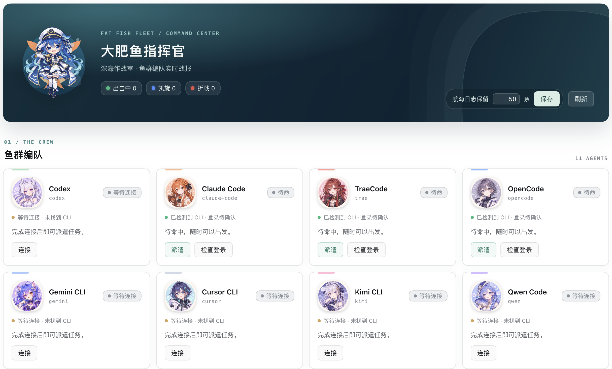

<div align="center">

# ⚡ dsh-agent-conductor · DSH 指挥家

**把任务交给合适的 Agent，让你的 AI 舰队一起出发。**

在 DeepSeek Harness 中向 11 种外部 Agent CLI 派遣任务，通过「大肥鱼指挥官」查看进度，并将结果带回对话。

**大肥鱼指挥官 · Big Fat Fish Commander**<br>
一间装着 11 位船员的深海指挥室。

[](../../LICENSE)

[**English**](../../README.md) · **简体中文**

</div>

---

## 🚀 在 DSH 中安装指挥官

1. 点击左侧 **「插件」**，进入 **「已安装」**。
2. 点击 **「添加插件」**，在「包名或地址」中填入：

   ```text
   dsh-agent-conductor
   ```

3. 点击 **「安装」**，按 DSH 提示完成操作；如提示重启，请重启 DSH。
4. 在左侧点击 **「指挥官」**。想要派遣的 CLI 还需单独安装并登录。

> 也可输入 GitHub 仓库地址 `https://github.com/MJorgin/dsh-agent-conductor` 安装源码版本。

## 🐟 欢迎来到指挥室



从 DSH 侧栏进入「**指挥官**」，查看船员和 CLI 检测状态，追踪派遣进度。点击「**连接**」获取安装或登录的对话引导；点击「**派遣**」，从一条可编辑的任务样例开始。打开的草稿不会自动发送。

### 认识船员


舰长与船员是为本项目生成的 AI 角色演绎，并非 CLI 厂商的官方形象。这里展示角色图集；面板中会将头像分配给对应 Agent。

> **找到 CLI 不等于已登录。** 面板能检测可执行文件，但不会把账号状态或派遣成功当成已确认。

> 灵感来自 [Multica](https://github.com/multica-ai/multica)——把"agent 小队"概念做成一个零安装成本的 DSH 技能。

## 🎯 什么时候该用 Conductor

- **独立第二意见**：让 Codex、Claude Code 或 Gemini 审同一个方案，再比较它们的判断。
- **老代码排查**：一个 Agent 追调用链，另一个查风险、回归影响和迁移方案。
- **跨模型实现**：选择更适合当前任务的模型或工具链，把最终结果带回 DSH。

## ✨ 你能得到什么

| 能力 | 做什么 | 成本 |
|---|---|---|
| 🧠 自动识别、自动派活 | 说一句「让 Codex 把这份 README 翻译一下」——模型匹配到本 skill，执行派发脚本，照着结果回答 | 免费（消耗目标 CLI 自己的额度） |
| 🔧 `conductor_dispatch` 工具（可选 bundle） | 同一套注册表，以 DSH 一等公民工具的形式提供，一条命令装进 profile | 免费 |
| 🐟 大肥鱼指挥官面板（bundle） | 侧栏里紧贴「更多」上方的一行：11 张 Q 版船员卡，实时状态、计时与输出尾迹，航海日志，单次详情 + 终止按钮，历史条数可调 | 免费 |
| 🩺 `doctor` 自检 | `python3 dispatch.py doctor` 先探测你装了哪些 CLI（解析 PATH + 试跑 `--version`），再决定派给谁 | 免费 |
| 👀 Dry-run 预览 | 不启动外部 Agent，先查看目标、工作目录、argv 和等价 shell 命令 | 免费 |
| 👥 11 种 agent CLI | Codex、Claude Code、TraeCode、OpenCode、Gemini、Cursor、Kimi、Qwen、Copilot、WorkBuddy、Grok | 各自 CLI 的登录额度 |
| 🔒 隐私 | 任务文本只发给目标 CLI 自己的服务方；密钥始终留在本地 | — |

## 为什么是 Skill

| | profile 插件 / bundle | 动态插件 | **Skill（本方案）** |
|---|---|---|---|
| 安装 | 写 profile + 重启 | 会话内定义 | **复制一个文件夹** |
| 触发 | 手动 | 模型调工具 | **描述匹配，模型自动识别** |
| 风险 | 需要重启、与宿主耦合 | 会话级、重启消失 | 只读脚本，宿主无感 |
| 结果 | 工具结果 | 工具结果 | **stdout 直接成为回答依据** |

一个 `SKILL.md` + 一个零依赖 `dispatch.py`（Python 标准库），完事。

## 安装（Skill 版）

把 `skills/conductor/` 复制到任意技能根目录（项目级 `.dsh/skills/` 或全局 `~/.dsh/skills/`）：

```sh
mkdir -p .dsh/skills/conductor
cp -R skills/conductor/. .dsh/skills/conductor/
```

装完无需重启——下次对话直接说：

- 「派 codex 把这份 README 翻译成繁体中文」
- 「让 Claude Code 查一下这个报错的成因」
- 「用 Codex 独立实现一个 XXX」

agent 会**自动识别**（SKILL.md 描述匹配）→ 执行 `dispatch.py` → 结果回传。

第一次使用某个 CLI、任务很长、或可能产生文件写入时，先预览；这一步不会消耗目标 Agent 额度：

```sh
python3 skills/conductor/scripts/dispatch.py --dry-run claude-code "阅读 src/auth.ts，解释 token 刷新流程。不要修改文件。"
```

## 🧭 Agent 能力矩阵

| 任务 | 优先考虑 | 原因 |
|---|---|---|
| 架构评审 / 第二意见 | Codex、Claude Code、Gemini | 不同推理风格更容易发现设计盲区 |
| 老代码调用链排查 | Claude Code、Codex、Copilot | 适合追踪仓库内依赖，并附上证据 |
| GitHub Issue / Actions 分析 | Copilot、Codex | 与仓库、PR、CI 诊断的场景贴合 |
| 与编辑器联动的重构 | Cursor、Codex | 适合和现有项目树紧密耦合的工作流 |
| 中文本地化 / 中文文档 | TraeCode、Qwen、Kimi、Codex | 中文能力选择较多；任务里要统一术语 |
| 快速替代实现 / 小规模 Spike | OpenCode、Qwen、Kimi | 适合边界清楚、可使用独立账号或工具链的尝试 |

这张表是路由起点，不是硬性规则。优先选择已经安装、已登录，并且能访问正确工作区的 CLI。

## 📋 可直接复制的派活模板

1. 安全诊断：

```text
你正在当前仓库中排查一个 bug。不要修改文件。
根据下面的描述复现问题：<粘贴错误和复现步骤>。
只阅读必要文件。返回：
1）根因；2）file:line 证据；3）三个按优先级排序的修复方案；
4）应该新增或更新的测试。
```

2. 独立架构评审：

```text
请以外部资深工程师视角评审这个设计，不要假设存在隐藏上下文。
设计摘要：<粘贴 PRD 或技术方案>。
重点挑战可扩展性、失败模式、安全边界和迁移风险。
先列出你不同意的点；每一点都要包含影响、证据和备选方案。
```

3. 有测试兜底的实现：

```text
请在当前仓库实现这个改动：<范围和验收标准>。
小步推进。实际可行时，先新增或更新测试。
结束前运行相关测试命令，并汇报：
修改文件、测试结果、剩余风险和后续事项。
```

## 前置：想派谁就装谁的 CLI

```sh
# Codex / Claude Code / OpenCode / Gemini / Qwen
npm i -g @openai/codex
npm i -g @anthropic-ai/claude-code
npm i -g opencode-ai
npm i -g @google/gemini-cli
npm i -g @qwen-code/qwen-code
# Kimi / Grok / Copilot（无头参数已逐一对照各 CLI 自带 --help 核实）
npm i -g @moonshot-ai/kimi-code
npm i -g @xai-official/grok
npm i -g @github/copilot
# TraeCode CLI：https://docs.trae.cn/cli_command-line-parameters
#（机器上已有 codex-cli 也可软链：ln -s ~/.codex/plugins/.plugin-appserver/codex ~/.local/bin/codex）
```

> 无头提示：Copilot 非交互模式必须自动放行工具，注册表实际执行 `copilot -p "<任务>" --allow-all-tools`；其余 CLI 用各自标准的 print/headless 参数。

装完先自检，看本机到底能派谁（解析 PATH + 试跑版本号）：

```sh
python3 skills/conductor/scripts/dispatch.py doctor
# ✅ Codex  …/codex — codex-cli 0.151.0 …
# ❌ Gemini … 未找到 `gemini`  →  安装：npm i -g @google/gemini-cli
```

> **工作目录自动识别。** bundle 工具会让 CLI 在当前会话工作区（`exec.agent.session.header.cwd`）里跑，其次读 `CONDUCTOR_CWD`，再次用宿主 cwd——不再写死任何路径。Codex 仍要求**受信任**的 git 仓库：若自动识别到的目录不被信任，就把 `CONDUCTOR_CWD=/path/to/git/repo` 写进 `~/.dsh/secrets/media-tools.env`（或导出环境变量）。Skill 脚本读 `CONDUCTOR_CWD`，缺省用当前目录。
> **Codex 模型覆盖。** Codex 的模型来自共享的 `~/.codex/config.toml`；若其中的模型当前账号不可用，设置 `CONDUCTOR_CODEX_MODEL=<model>`（环境变量或 `~/.dsh/secrets/media-tools.env`），bundle/动态插件工具与 skill 脚本都会自动插入 `-m <model>`。
> **Windows。** skill 脚本按 `PATHEXT` 解析 npm 的 `.CMD` shim，并按 UTF-8 解码 CLI 输出（`errors="replace"`），GBK/ANSI 代码页下也不会丢结果。bundle 工具走宿主 `subprocess` 服务，argv 从不经 shell，所以在 Windows 上要求 CLI 有原生 `.exe` 入口；只有 npm shim 的 CLI 请用 skill 脚本派活。
> 想让派出的 agent 能写文件：Codex 的 `~/.codex/config.toml` 加 `sandbox_mode = "workspace-write"`。
> 派活消耗对方 CLI 的登录额度。

## 已验证 vs 待验证

| CLI | 无头命令 | 状态 |
|---|---|---|
| Codex | `codex exec "{task}"` | ✅ 真机实测（翻译任务已产出交付） |
| Claude Code | `claude -p "{task}" --output-format text` | ✅ 本机已装；官方文档 |
| TraeCode | `traecli exec "{task}"` | ✅ 官方文档 |
| OpenCode | `opencode run "{task}"` | ✅ 官方文档 |
| Gemini CLI | `gemini -p "{task}"` | ✅ 官方文档 |
| Qwen Code | `qwen --prompt "{task}"` | ✅ 官方文档（Gemini-CLI 分支） |
| Kimi CLI | `kimi --prompt "{task}"` | ✅ 对照 CLI 自带 help 确认（`-p, --prompt` 即非交互） |
| Copilot CLI | `copilot -p "{task}" --allow-all-tools` | ✅ 对照 `copilot --help` 确认（可执行名是 `copilot` 而非 `github-copilot`；无头必须带 `--allow-all-tools`） |
| Grok CLI | `grok -p "{task}"` | ✅ 官方 README（`grok -p "..."` 即跑单个任务） |
| Cursor CLI | `cursor-agent -p "{task}"` | ⏳ 命令形态待实测（走 cursor.com 安装；npm 上的 `cursor-agent` 包与此无关） |
| WorkBuddy | `workbuddy -p "{task}"` | ⏳ 命令形态待实测 |

> 安装包已对照 npm registry 核实：Kimi 是 `@moonshot-ai/kimi-code`（bin `kimi`）、Grok 是 `@xai-official/grok`（bin `grok`）、Copilot 是 `@github/copilot`（bin `copilot`）、Codex 是 `@openai/codex`。npm 上的 `kimi-cli` 是个没有二进制的占位包，请勿使用。

## 🐟 大肥鱼指挥官面板（0.4.0+）

bundle 现在也带浏览器半边：左侧栏新增 **指挥官** 一行，紧贴内置的 **更多** 菜单上方——面板中文名是 **大肥鱼指挥官**。它把派活变成一间小小的「深海作战室」：

- **鱼群编队**：保留蓝发鲸鱼少女舰长，11 位 CLI 头像根据提供的角色参考图重新生成并统一画风。船员卡显示 CLI 检测结果、任务状态、计时和 stdout 尾迹；执行中的动画支持系统的减少动态效果设置；
- **连接与派遣**：面板检测 CLI 可执行文件。点击「连接」获取安装、登录的对话引导；检测到 CLI 的船员可点「派遣」，编辑任务样例并打开对话草稿。草稿不会自动发送或执行，请发送前核对工作区；
- **航海日志**：最近 N 条派活记录（默认 50，面板头部可调）。已完成任务的摘要和保留设置保存在 `~/.dsh/conductor-crew.json`，重启后恢复；点击可查看详情；
- **详情与终止**：宿主运行期间可查看命令参数、工作目录、耗时、退出码、stdout/stderr 尾迹和错误；打开的详情会自动刷新，**终止**按钮可结束执行中的进程树；
- 页面只在可见时轮询同源 `/conductor/state`，数据不出本机。

说明：

- 检测到 CLI 只表示找到了可执行文件，**不代表已登录、拥有额度或派遣一定成功**；登录仍需用户自行完成。
- 只有走 bundle `conductor_dispatch` 工具的派活会出现在面板里；skill 的 `dispatch.py` 是普通子进程，不登记运行记录——这是刻意的。
- 船员与舰长是参考图片后生成的 AI 演绎，并非各厂商官方角色；素材随插件本地提供，加载失败时回退原 SVG。角色方向参考了 [dsh-pet](https://github.com/PC2005-cloud/dsh-pet)，未直接打包其美术素材。
- 为控制本地存储和减少敏感数据落盘，重启后仅恢复任务摘要；命令参数和输出尾迹只在内存中保留。任务预览、工作目录和错误摘要会写入本地，可能包含敏感文字。
- 没有 web server 的 CLI/headless profile 仍然只有工具：路由按需注册，用不到就不存在。

## 📦 可选：安装 bundle（工具 + 面板）

仓库同时是一个 dsh bundle——宿主半边（`dsh.bundle`）+ 浏览器半边（`dsh.client.platform = "web"`），一条命令装进 profile：

```sh
dsh plugin --profile desktop add github:MJorgin/dsh-agent-conductor
```

profile 不叫 `desktop` 就换成你的名字；如 DSH 提示重启，请按提示操作，替换已安装包时可能需要重启才能加载新的 client module。图形界面操作见[在 DSH 中安装指挥官](#-在-dsh-中安装指挥官)。

- 工具、面板与技能三处共用同一份 CLI 注册表（`index.js` ⇄ `conductor-dynamic.js` ⇄ `dispatch.py`，新增 CLI 时保持同步）；
- 浏览器半边是手写 client module（`client.js`）：通过 `ctx.slots` 注册左侧一行和 `main` 页面，且只访问同源 `/conductor` 路由；
- 宿主执行更稳：支持 Dry-run 预览；显式声明 `subprocess` 依赖；真正的 10 分钟超时会**终止整个进程树**（取消时同样清理，不留孤儿进程）；超长输出自动截断（保留头+尾，约 2 万字符），避免话痨 agent 撑爆上下文；stderr 同样有界（头+滚动尾），真正的尾部报错不会丢；
- 面板打开时会占用主区（对话区），从左侧栏切回任意会话即可；页面只使用 `--dsw-alias-*` 主题 token，自动跟随明暗；
- 面板之外的任务看板回收仍在路线图上。

## 仓库内容

```
index.js                      # bundle 宿主半边：conductor_dispatch 工具 + /conductor 路由
conductor-store.js            # 面板背后的运行登记表（纯函数，有单测）
client.js                     # 浏览器半边：指挥官侧栏行 + 大肥鱼指挥官页面
cordis.patch.yml              # bundle 层（单行宿主注册）
skills/conductor/SKILL.md      # 技能定义：触发描述 + 派活规则 + 隐私
skills/conductor/scripts/dispatch.py  # 派活引擎（Python 标准库，零依赖）
conductor-dynamic.js           # 备选：动态插件版（只有工具，没有面板）
tests/                         # 截断、登记表、路由、client module 与 CLI 胶水测试
```

## 路线图

- [x] `doctor` 健康检查和 Dry-run 预览
- [x] 大肥鱼指挥官面板——实时编队状态、航海日志、单次详情 + 终止（0.4.0）
- [x] 参考角色形象生成统一画风的船员与鲸鱼舰长（保留 SVG 兜底）
- [ ] 按能力、速度和成本选择 Agent
- [ ] 任务看板回收：派活结果写入 dsh-task-board 卡片
- [ ] 小队编排：一个任务分发给多个 agent 汇总（Multica squads 形态）

## 隐私

- Key 永不写进仓库；脚本读环境变量或 `~/.dsh/secrets/media-tools.env`（与 dsh-media-skills 同一约定）。
- 面板数据只在本地：已完成任务的摘要与设置保存在 `~/.dsh/conductor-crew.json`，命令参数和输出尾迹保留在内存，不会上传。
- 任务文本会发给对应 CLI 的服务商，敏感信息（密钥、内部数据）不要写进任务。
- 结果的版权/合规归属对应 CLI 的服务条款，交付时如实标注「由 <agent 名> 完成」。

## License

[MIT](../../LICENSE)

## 相关链接

- 🎨 [dsh-media-skills](https://github.com/MJorgin/dsh-media-skills) —— 同作者的 DSH 读图/生图插件（GLM-4V-Flash + Qwen3-VL + Gemini 三引擎容错）
- ⚡ 本仓库：[dsh-agent-conductor](https://github.com/MJorgin/dsh-agent-conductor)
- 📬 社区收录 PR：[awesome-dsh-plugin#664](https://github.com/awesome-dsh-plugin/awesome-dsh-plugin/pull/664)
- 📋 精选列表：[awesome-dsh-plugin](https://github.com/awesome-dsh-plugin/awesome-dsh-plugin) · 生态索引：[dsh-plugin topic](https://github.com/topics/dsh-plugin)
- 🎯 对标：[Multica](https://github.com/multica-ai/multica)（多 agent 工作台）· [dsh-web-ui](https://github.com/zhu1090093659/dsh-web-ui)（任务看板）
